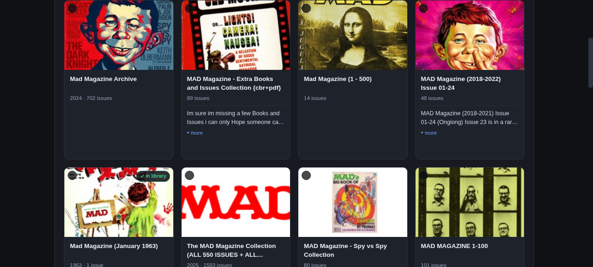
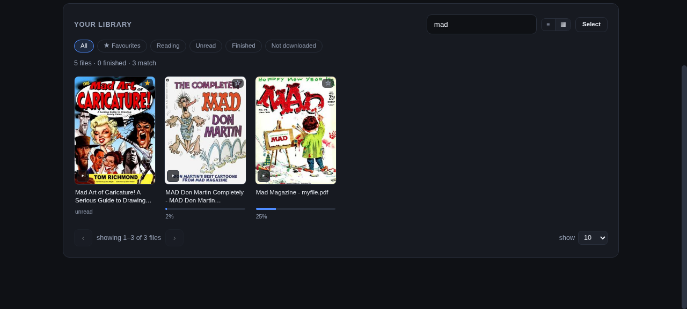
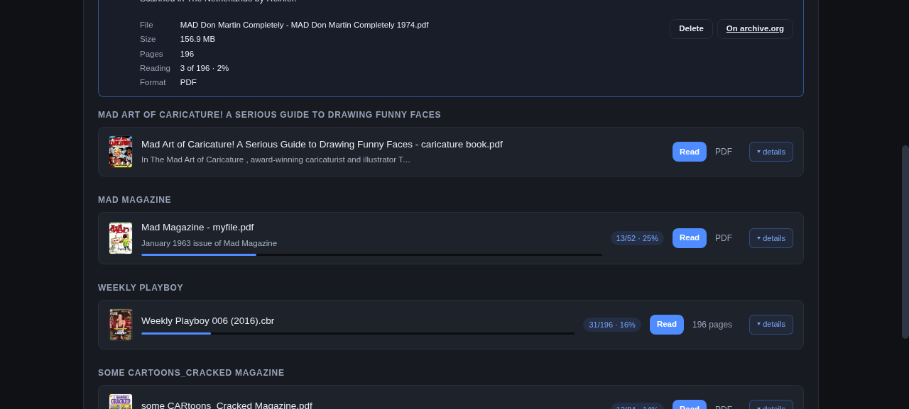
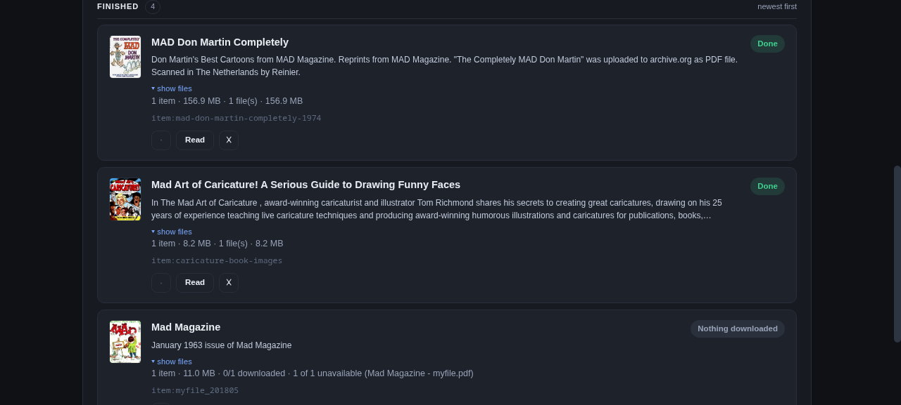

# HardlyReading

Desktop-friendly web app for grabbing magazines, comics and PDFs from
[Internet Archive](https://archive.org) and reading them locally.

> **Built with AI.** HardlyReading was made using **DeepSeek V4.1 Flash** running
> inside a **Hermes agent** — an autonomous coding agent that wrote the code,
> ran the tests and cut the releases. It is a real, working program, but it was
> not hand-typed by a person, and it has only been tested on Linux (see
> [Limitations](#limitations)).

Paste a collection link (or an item link, or a search result), it resolves every
member, downloads one good file per issue — **CBZ/CBR first, then PDF** — verifies
each one against archive.org's checksum, and files it into a Komga-compatible
folder so a comic server can read it without manual tidying.

Everything runs on your own machine. No account, no cloud, no telemetry.

> ### ☕ This app is useless without the Internet Archive
>
> Every search, every scan and every download comes from
> [archive.org](https://archive.org) — a non-profit library that runs on
> donations. If HardlyReading is useful to you,
> **[donate to keep it online →](https://archive.org/donate)**

---

## How it works

Four files, no framework, no build step:

| File | Role |
|---|---|
| `run.py` | Launcher. Checks Python and `aria2c`, then starts the server and opens your browser. |
| `engine.py` | Everything that isn't the web layer: talking to archive.org, resolving links, planning filenames, downloading, verifying, the queue, and reading positions. |
| `server.py` | A small `http.server` wrapper. Serves `index.html` and exposes the engine as JSON endpoints. |
| `index.html` | The whole UI — HTML, CSS and JS in one file. Polls `/api/state` and re-renders. |

A job moves through these stages:

```
paste link ──▶ resolve ──▶ plan names ──▶ download ──▶ verify ──▶ library
```

1. **Resolve.** A `/details/` item is one entry. A collection or a search is
   turned into a list of identifiers via archive.org's advancedsearch API, then
   each item is probed in parallel. `pick_file()` chooses one artifact per item:
   CBR → CBZ → image-PDF → text-PDF, preferring `source == original` and the
   largest file within a format.
2. **Plan names.** `plan_filenames()` builds `<Series> NNN (Year).ext` for every
   entry, sorted by printed issue number. This happens *before* downloading, so
   the name used on disk, the name used for verification and the name shown in
   the UI are the same string.
3. **Download.** `aria2c` fetches each file, resuming partials with `-c`. Files
   already present at the right size are skipped.
4. **Verify.** Size and MD5 are checked against archive.org's metadata. A
   mismatch is a failure, not a silent pass.
5. **Library.** Entries with a verified file appear on the Library tab. Reading
   position is written to SQLite keyed by `ia:<identifier>:<artifact>`.

The engine owns a single worker thread (`Engine._run`). Jobs sit in a list,
each with a status; the worker takes the next runnable one and advances it. The
UI never drives a download directly — it only posts intent and reads back state.

## What it does

- **Paste links** — `archive.org/details/...` collections, single items, or
  archive.org search URLs. Collections pull every member.
- **Search inside the app** — title-scoped so you get the publication you typed,
  not 1,000 full-text matches. Filters for collections and multi-issue listings.
- **Picks the best file per issue** — CBR → CBZ → image-PDF → text-PDF, prefers
  original scans over derivatives, skips superseded `history/` copies.
- **Verifies every download** — byte size and MD5 against archive.org's metadata.
  Worth doing: archive.org sometimes serves an error page with HTTP 200.
- **Resumes after a crash** — restart the app and interrupted downloads continue
  from where they stopped, finished files are skipped.
- **Retries sensibly** — transient failures back off 15m → 1h → 3h → 8h. Genuinely
  missing items are marked unavailable instead of retrying forever.
- **Komga-ready output** — one folder per series, files named `<Series> NNN (Year).ext`
  so they sort in reading order.
- **Library + reader** — list or cover-grid view, filter chips (favourites,
  reading, unread, finished, not downloaded), a search box, and favourites.
  Open a CBZ or PDF; progress is saved server-side in SQLite so it follows you
  between devices.
- **Read without downloading** — stream a book's pages straight from
  archive.org, with the same reader and the same saved position.
- **A queue that shows its work** — grouped into Downloading now / Needs
  attention / Waiting / Finished, with per-file progress for concurrent
  transfers.

## Screenshots

Search — descriptions under each result, click **more** for the whole blurb;
tick the ones you want and add them together:



The library, as a cover grid or a list. Filter chips narrow it; the star marks
favourites; **details** on a row opens size, pages, position and actions:

| Cover grid | List with details |
|---|---|
|  |  |

The queue says what it is doing — Downloading now, Needs attention, Waiting,
Finished — and a running job lists every file in flight:



Reader — fits the page, arrow keys to turn, remembers your place:


## Requirements

- **Python 3.8+** (stdlib only — nothing to `pip install`)
- **aria2c** — the downloader. Required.

Install aria2:

| Platform | Command |
|---|---|
| Windows | `winget install aria2.aria2` |
| macOS | `brew install aria2` |
| Debian / Ubuntu | `sudo apt install aria2` |
| Fedora | `sudo dnf install aria2` |
| Arch | `sudo pacman -S aria2` |

## Run it

```bash
python run.py
```

Your browser opens at `http://127.0.0.1:8788`. Leave the terminal window open
while you use it; close it to stop.

`run.py` checks your Python, finds aria2c, and tells you exactly what to install
if anything is missing — it will not half-start.

## Using it

1. **Paste links** into the box on the Downloads tab, or search archive.org in the
   Search tab, tick the results you want, and press **Add to queue**.
2. A **Ready** card appears showing how many items and how much disk it needs.
   Download is disabled if the grab will not fit.
3. Press **Download**. Progress, speed and current file update live.
4. When it finishes, **Read** opens it in the built-in reader, or **Open folder**
   shows the files.

### Searching and picking

Search results are **ticked, not added on click** — click a card to select it,
then use the bar that appears to queue the whole selection at once. Nothing is
queued until you say so.

**Add all results to queue** asks for confirmation first, because one click can
queue a thousand items.

Each card carries a badge once that item is known to the queue, with a different
symbol per state:

| Symbol | State |
|---|---|
| `✓ in library` | Downloaded and verified |
| `◷ queued` / `◷ ready` / `◷ resuming` | Waiting or planned |
| `↓ downloading` | Transferring now |
| `◌ resolving` / `◌ verifying` | Looking it up or checking the checksum |
| `✕ failed` | Gave up — see the queue card for why |
| `– cancelled` / `– unavailable` | Cancelled, or nothing downloadable in that item |

A queued card offers **Remove from queue**; a downloaded card offers
**Open in library**, which jumps to the file and highlights it. Deleting a
downloaded file only happens in the Library, never from search.

### Install it as an app (PWA)

HardlyReading ships a manifest and a service worker, so a browser can install it:
in Chrome or Edge use the install icon in the address bar; on Android use *Add to
home screen*; Safari on iOS uses *Share → Add to Home Screen*. It opens in its own
window with the HR icon and no address bar.

What that does and does not buy you, plainly:

- **Works:** the app shell opens with no network and says "Disconnected" instead
  of showing a browser error page.
- **Does not work offline:** searching, queueing and downloading all need
  archive.org, so an offline install is a viewer for nothing. Files you already
  downloaded still open, because they are served by your own machine.
- **Never cached:** every `/api/*` response. A cached queue would show jobs that
  are not running, so the worker refuses to store them.
- Install prompts need `https://` or `localhost`. On a plain-HTTP LAN address the
  page still works, it just will not offer to install.

### The library: grid, filters, favourites

Two views — a **list** for detail and a **cover grid** for browsing — switched
with the toggle beside the filter box and remembered per browser.

Filter chips narrow the shelf: **All**, **★ Favourites**, **Reading**, **Unread**,
**Finished**, **Not downloaded**. They stack with the text filter (which also
searches descriptions), and the pager counts what is left.

**Favourites** are a star on every row and card, stored in SQLite under the same
key as reading progress — so a favourite survives a re-scan, a re-download and a
restart.

PDF covers are rendered from page one with poppler's `pdftoppm` when it is
installed; without it a PDF keeps a plain "PDF" tile rather than a broken image.

### The library also shows what you have not downloaded yet

A title the queue knows about but which is not on disk still appears, marked
`not downloaded`, with the action that moves it forward — **Download** for
planned work, **Retry** for failed work — and a link to its page on archive.org
where the built-in viewer can show it without downloading anything.

Files caught mid-download are marked partial and refuse to open: a half-written
archive is not a book. Rows with no file behind them cannot be selected for
deletion, because there is nothing to delete.

Library rows carry a real cover — page one, scaled to 96 px and cached — so the
shelf looks like a shelf. PDFs get a placeholder rather than a rendered cover.

Clicking a row expands it rather than opening the book: the panel underneath
shows the full file name, size, page count, reading position and format, with
that row's actions — **Read**, **Show in folder**, **Delete**, and a link to the
item on archive.org. Reading is an explicit choice, so a stray click on a list
of files cannot take over the screen.

## The queue is a real queue: you control the order

Adding a link starts it straight away; when a job finishes the next one starts
on its own, with a pause between jobs set by **Pause between jobs** in Settings
(30 s by default, `0` for back-to-back). A job that fails is marked failed and
the queue carries on rather than stalling.

Jobs run in the order they appear. Every waiting job has four buttons —
`⤒` top, `▲` up one, `▼` down one, `⤓` bottom — and the `#3` chip on a card is
its actual place in the run order, not its row number. Only waiting work can be
moved: reordering a download already in flight would promise an order the file
transfer cannot honour. The order is saved in `state.json`, so it survives a
restart.

### Deleting from the library

Deleting is deliberately not an always-visible button. Press **Select** in the
Library, tick the files you want gone, then **Delete** — it confirms with the
list of filenames before touching disk. Press **Cancel** or **Done** to leave
select mode without deleting anything.

### Paging, covers and descriptions

Every list pages at **10 / 25 / 50 / 100** per page, with prev/next and a
jump-to-page list; the size you pick is remembered per tab. The queue and the
library page locally, search pages on the server because a search can match tens
of thousands of items.

Search results carry the archive.org description, cut to two lines — click it to
read the whole thing. That click expands the text rather than toggling the card,
so you cannot lose a selection by trying to read it.

Queue cards show the item's cover and expand on click to list the files inside
the job. The list is fetched when you open the card, not with the 1.2 s poll, so
a collection of 400 issues costs nothing until you ask for it. A card you opened
stays open.

## Start it on boot

There are two ways to do this, and the first one is a switch.

**In the app:** Settings → Start-up → **Start when the computer starts**. It
writes a systemd user unit for *this* install — its folder, its port, a system
interpreter — and enables it. Switching it off removes the unit. It is off
unless you turn it on, and it reports "unsupported" on systems without systemd.

The queue does not depend on this: `state.json` holds it, and aria2 resumes its
`.aria2` partial files, so a restart continues where it stopped either way.

**By hand**, if you prefer to keep the unit yourself:


```sh
mkdir -p ~/.config/systemd/user
cp contrib/hardlyreading.service ~/.config/systemd/user/
# edit WorkingDirectory and the IA_ARIA2 path to match your setup
systemctl --user daemon-reload
systemctl --user enable --now hardlyreading.service
```

`Restart=on-failure` brings it back if it dies. A user unit starts at login;
add `loginctl enable-linger "$USER"` if the machine should serve it without
anyone logging in.

## Read a book without downloading it

Rows for work that is not on disk have a **Read** button. It streams page images
from archive.org — a few hundred kB per page — so you can look at an issue
immediately and decide whether it is worth keeping. Reading progress is saved in
the same table as downloaded books, so a streamed book resumes where you left it
and shows up in your history either way.

The trade is stated in the reader rather than hidden: streaming needs a
connection every page, the images are lower resolution than the archive itself,
and nothing is available offline. **Download it** in that note fetches the real
file without closing the book.

Page counts come from the item's OCR page index. archive.org does not publish a
count for most comics and serves pages past the end as repeats instead of
errors, so when no index exists the reader shows `?` rather than invent a total.

## The library reads the folder, not just the queue

The Library lists what is actually in your **download folder** — the one set in
Settings, default `~/Documents/HardlyReading`, including its series subfolders.
Files are matched against the queue first, then the folder is scanned for
anything else, so a download from an earlier run, a file you copied in by hand,
or a leftover after removing the job that fetched it all still appear and open.

Downloads go into that same folder, one subfolder per series. Change the
download folder in Settings and the Library follows it; it does not look
anywhere else on disk.

Each row shows how far you have read: a progress bar and `page/total · percent`
once you have started, and a dimmed row with a `finished` badge when you reach
the end. **Clear reading history** in Settings forgets every saved position —
files are untouched.

Files land in your downloads folder — `~/Documents/HardlyReading` unless you
change it — under one subfolder per series:

```
~/Documents/HardlyReading/
└── MAD Magazine/
    ├── MAD Magazine 179 (1976).cbz
    └── MAD Magazine 180 (1976).cbz
```

Point Komga (or any comic server) at that folder and each subfolder becomes a
series.

## The reader

Deliberately minimal: one page at a time, **fitted to the window** — the whole
page, not a zoomed slice you have to scroll — `←`/`→` or the arrow buttons to
turn, `Esc` to close.

Zoom is `−` / `+` / `Fit` (or the `-`, `+` and `0` keys). Fit means the page
fits both the width and the height of the pane whatever size the window is; the
percentage is relative to that, so 125% is a bit bigger than fit, not an
absolute scale. Zoomed in, the pane scrolls. CBZ pages are read straight out of the zip
by the server. PDFs are drawn by [pdf.js](https://mozilla.github.io/pdf.js/),
bundled in `vendor/` (about 1.7 MB, Apache-2.0) rather than loaded from a CDN, so
the app works offline apart from archive.org itself.

Reading position is stored in SQLite on the machine running the app
(`history.db`), keyed by the archive.org identifier — so the same book resumes
in the same place whatever device or browser you open it from.

## Settings

The gear in the header opens a panel; changes save as you edit and persist in
`state.json`:

| Setting | Default | What it does |
|---|---|---|
| Start when the computer starts | **off** | Installs a systemd user unit for this install. The queue survives a restart either way. |
| Download folder | *empty* | Empty means `~/Documents/HardlyReading`, created on the first download. Point it anywhere else and the Library follows it. |
| Show "reader" label | on | The small label in the reader header. Off gives a clean page. |
| Clear reading history | — | Forgets every saved page position. Files stay on disk. |
| Ask before downloading | on | Show the file plan and total size, then wait for you. |
| Skip files I already have | on | Drop entries whose checksum is already in the folder. |
| Komga folder naming | on | One folder per series with issue-ordered filenames. Off keeps archive.org's original filenames in a folder named after the link. |
| Parallel files | 12 | How many files aria2 fetches at once — the queue card shows each one. |
| Pause between jobs | 30s | Gap between one job finishing and the next starting. |

Job cards can be **cancelled** before they start and **removed** from the list,
and library items can be **deleted** (file plus its reading position).

## Where things are stored

| What | Windows | macOS | Linux |
|---|---|---|---|
| Settings & queue | `%APPDATA%\hardlyreading` | `~/Library/Application Support/hardlyreading` | `~/.config/hardlyreading` |
| Downloads | `%USERPROFILE%\Documents\HardlyReading` | `~/Documents/HardlyReading` | `~/Documents/HardlyReading` |
| Cached covers & streamed pages | under the settings folder: `thumbs/`, `stream/` | same | same |

## Limitations

Worth knowing before you point it at a 500-issue collection:

- **Archive.org's metadata is often wrong.** Publication years in particular get
  batch-assigned at upload time, so the year in a filename can be the scan year
  rather than the cover date. Issue numbers are far more reliable, which is why
  they drive the ordering.
- **Ordering is by issue number, not archive's sort order.** Archive's own sorts
  are unreliable for this: unsorted is arbitrary, `year asc` groups by scan year
  with arbitrary ties, and `titleSorter` only works within a single title (a
  collection holding fifteen different magazines alphabeticalises the spin-offs).
- **One file per issue.** If an issue exists as both CBR and PDF, the CBR wins;
  the PDF is not also downloaded.
- **Only documents.** Search is pinned to `mediatype:texts` — no video, audio or
  software.
- **No re-verification sweep.** Files are verified when downloaded, not re-checked
  later. If a file gets corrupted on disk, delete it and grab it again.
- **CBR needs a RAR extractor.** CBZ is read with the Python stdlib; CBR is RAR,
  so reading one requires `unrar`, `bsdtar`, or `7z` on PATH. Without one, CBR
  files still download and are named correctly — they just aren't readable in-app.
- **PDF page counts can be wrong before you open a file.** The list is built
  without a rendering library, by counting page objects in the file; PDFs that
  compress their object streams report nothing until pdf.js opens them and
  records the real total with your position.
- **Search is live, not local.** Every query goes to archive.org; there is no
  offline catalogue. What *is* stored locally is your reading positions,
  descriptions, favourites and cached images, in SQLite and two cache folders.
  archive.org also refuses pages past its 10,000-result ceiling — the search
  falls back to page 1 and says so.
- **Read without downloading needs a connection** for every page, and the pages
  are lower resolution than the file. The reader says so in a note you can
  dismiss; **Download it** in that note fetches the real file.
- **Lendable items still won't work.** Items that require borrowing ("restricted",
  "lending", "borrow") are treated as permanently unavailable — a streaming
  reader does not get around archive.org's lending.
- **PDF covers need poppler.** The library renders page one of a PDF with
  `pdftoppm` when it is installed. Without it a PDF shows a plain tile.
- **Tested on Linux.** `run.py` handles Windows and macOS paths, the `aria2c.exe`
  lookup and the winget fallback, but has not been run on those platforms — treat
  them as untested rather than supported. Start-on-boot is systemd-only.

## Skipping what you already have

Before downloading a resolved collection, HardlyReading checks the destination
folder against archive.org's checksums and drops any file whose MD5 is already
there — so re-running a grab, or grabbing an overlapping collection, only
fetches what is actually missing. The checksum index is cached in
`.md5-index.json` so it is not rehashed on every run.

## Legal

Internet Archive hosts material under a wide range of rights. Downloading
something does not give you the right to redistribute it. Check what you are
downloading.

## Changelog

What changed in each release: [CHANGELOG.md](CHANGELOG.md).

## License

HardlyReading is free software: you can redistribute it and/or modify it under
the terms of the **GNU General Public License, version 3 or later**.

It is distributed in the hope that it will be useful, but **without any
warranty**; without even the implied warranty of merchantability or fitness for
a particular purpose. See [LICENSE](LICENSE) for the full text.

```
Copyright (C) 2026 hardlysleeping
```

Full licence: <https://www.gnu.org/licenses/gpl-3.0.html>

## Support

[](https://www.paypal.com/donate/?hosted_button_id=RNT5W4XNC64EY)
